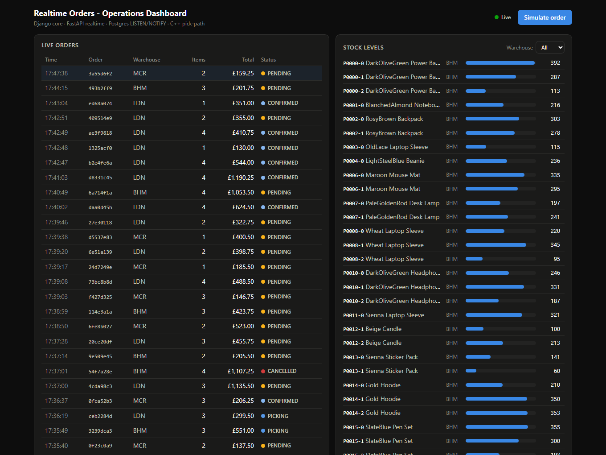
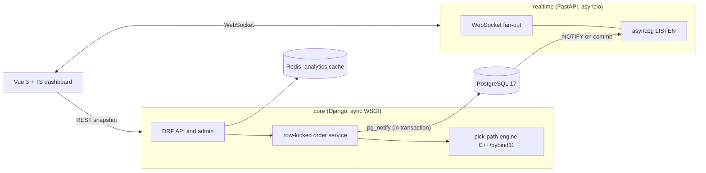

# Real-time Order & Inventory Operations Platform

[](https://github.com/ariyan-tipu/realtime-orders-platform/actions/workflows/ci.yml)
[](LICENSE)


A small e-commerce backend that concentrates on two hard parts of order
handling and one performance problem underneath them:

1. **Concurrency correctness.** Many orders decrement the same stock at
   once. Every write goes through one service that takes
   `SELECT ... FOR UPDATE` row locks in a global order, so writers using it
   cannot oversell and cannot deadlock on lock ordering, and tests that fire
   genuinely simultaneous transactions prove it.
2. **Live updates without polling.** Order and stock events reach browser
   dashboards over WebSockets, fed by PostgreSQL `LISTEN/NOTIFY`, so an
   event can never exist for a rolled-back transaction.

There is also a third, quieter problem: a CPU-bound warehouse pick-path
optimiser, written twice on purpose. A pure-Python reference implementation
and a C++ (pybind11) engine are proven behaviourally identical by an
exact-parity test suite.

**[Open the dashboard demo](https://ariyan-tipu.github.io/realtime-orders-platform/)**
(no install, runs in the browser) or
[run the real stack](#quickstart) with one `docker compose up`.



What that demo is, since the distinction matters: the production dashboard
build with its event source swapped for an in-browser simulation, and the
page says so at the top. There is no server behind it, because GitHub Pages
cannot run Django, FastAPI and PostgreSQL. It shows the UI, the
snapshot-then-deltas update model and the pick-path optimiser, whose
heuristic is [ported to TypeScript](frontend/src/demo/pickpath.ts) with the
same tie-breaking rules, so the routes drawn are the routes the real engines
return. It cannot show the part that matters most: one browser thread means
no contention and nothing for row locking to protect. Those guarantees are
proven by the test suite against a real PostgreSQL, which is what the
quickstart runs.

## Architecture



Why two services: Django's synchronous worker model is right for
transactional business logic and wrong for thousands of idle WebSockets. An
asyncio event loop is the reverse. The realtime service runs no queries and
holds no state, so it scales horizontally with no coordination at all.
Full reasoning: [docs/architecture.md](docs/architecture.md) and the
[ADRs](docs/adr).

## The interesting parts

### 1. Overselling cannot happen through the order service

Every stock mutation goes through one service function that locks the rows
it will touch, always in primary-key order, so two transactions can never
hold pieces of each other's lock set. Under PostgreSQL's `FOR UPDATE`
semantics that rules out both the oversell and lock-ordering deadlocks, for
writers that go through this path; the
[trade-offs section](#trade-offs-and-limitations) says what happens to code
that does not.

```python
locked = list(
    Stock.objects.select_for_update(of=("self",))
    .filter(warehouse=warehouse, variant_id__in=variant_ids)
    .order_by("pk")           # global lock order, so no deadlocks
)
# availability is checked under the lock; any shortage rolls back all of it
```

The test that pins the claim down: eight threads, five units, and a
barrier so they hit PostgreSQL together.

```python
results = run_in_threads([buy] * 8)
assert sum(1 for r in results if r[0] == "ok") == 5          # exactly five
assert sum(1 for r in results if r[0] == "insufficient") == 3
assert Stock.objects.get(variant=variant).quantity == 0      # never negative
```

Two more concurrency tests pin the deadlock-freedom claim (opposite item
orderings, repeatedly) and unit conservation when cancellations race
placements ([tests/test_concurrency.py](services/core/tests/test_concurrency.py)).

### 2. Events that cannot lie

`pg_notify()` is called on the same connection, inside the same transaction
as the stock change. PostgreSQL delivers notifications only on commit, so
the realtime service can never broadcast an order that was rolled back.
There is no outbox machinery and no dual-write race to worry about. A test
covers the negative case too: a rolled-back oversell emits nothing at all
([tests/test_notify.py](services/core/tests/test_notify.py)).
Trade-offs against Redis pub/sub: [ADR 0002](docs/adr/0002-postgres-listen-notify-for-events.md).

### 3. C++ where CPU time is real, with a provably-equal fallback

Pick-path optimisation (nearest-neighbour plus 2-opt over the warehouse
grid's Manhattan metric) is a pure-CPU loop on the request path, quadratic
per pass. The C++ engine releases the GIL while it runs; the pure-Python
twin keeps every environment working. Both are deterministic with identical
tie-breaking, so a 150-case randomised parity suite asserts exact sequence
equality, and a Held-Karp exact solver bounds solution quality on small
instances.

One representative CI run (ubuntu-latest, GCC -O2 via scikit-build-core).
These are microbenchmarks on a shared runner, so the absolute timings and
the exact multipliers move by 10-20% from run to run; the table is
regenerated in every run's job summary, and `make bench` prints your own:

| Bins per order | Python (ms/route) | C++ (ms/route) | Speedup |
|---:|---:|---:|---:|
| 8 | 0.055 | 0.003 | ~20x |
| 15 | 0.184 | 0.007 | ~30x |
| 25 | 0.711 | 0.009 | ~80x |
| 40 | 2.304 | 0.022 | ~100x |
| 60 | 7.446 | 0.063 | ~115x |

The stable, reproducible finding is the shape, not any single figure: the
speedup grows with order size, from tens of times at small orders to
around two orders of magnitude at the largest, which is what removing
interpreter overhead from a quadratic loop should look like. Solution
quality against the exact Held-Karp optimum (n <= 9, 30 instances): mean
within 0.2%, worst case 2.9%. Reproduce with `make bench`.

### 4. A query worth explaining

"Top-selling products per warehouse in the last 24 hours": three joins, a
grouped aggregation and a per-warehouse `RANK()` window, supported by a
partial covering index (`created_at WHERE status <> 'CANCELLED' INCLUDE
(warehouse_id, id)`). A management command measures the plan with and
without the index by dropping it inside a rolled-back transaction. Measured
on 240k orders with a 24-hour window matching 0.09% of history:

| Variant | Plan | Execution time |
|---|---|---:|
| With index | **Index Only Scan** (Heap Fetches: 0) then Nested Loop via FK index | **4.08 ms** |
| Without index | Parallel Seq Scan over 240k rows | 104.98 ms (**25.7x slower**) |

The write-up tells the whole story, including the first index design that
the planner rightly ignored (it did not cover the join key) and the
selectivity regime where a seq scan legitimately wins. Full plans and
reasoning: [docs/query-optimisation.md](docs/query-optimisation.md).

### 5. A demo that is still allowed to say no

The tempting shortcut for a public demo (open everything, it is only seed
data) quietly breaks the guarantee in section 1: cancelling an order returns
its units to stock and order ids are readable from the list endpoint, so
"anyone may cancel anything" hands a stranger the ability to move inventory.
Three tiers instead, set as a project-wide default in
[config/permissions.py](services/core/config/permissions.py) rather than
view by view, so a view added later inherits the restriction instead of
DRF's `AllowAny`:

| Tier | What | Who |
|---|---|---|
| Read | catalogue, stock, orders, pick paths, analytics | anyone; this is what the dashboard renders |
| Public write | place an order, demo traffic generator | anyone **while `DEMO_MODE` is on**, otherwise authenticated only |
| Operator | advance or cancel an existing order | authenticated, always, demo mode or not |

Every environment switch defaults to the closed setting, and the service
refuses to boot without an explicit `DJANGO_SECRET_KEY` when debug is off
rather than falling back to one committed to this repository. Tests cover
the negative cases, including an anonymous attempt to cancel someone else's
order returning 403 with the stock level unmoved
([tests/test_api.py](services/core/tests/test_api.py)), and CI runs
`manage.py check --deploy --fail-level WARNING` on every push. One place
where "secure by default" is wrong is worth knowing about: HSTS, the HTTPS
redirect and secure-only cookies sit behind `DJANGO_BEHIND_TLS` rather than
following `DEBUG`, because the bundled nginx listens on port 80 and turning
them on without a certificate in front is an outage rather than a hardening
step. The reasoning, the tier definitions and the known limits of this model
are in [SECURITY.md](SECURITY.md).

## Quickstart

```bash
git clone https://github.com/ariyan-tipu/realtime-orders-platform.git
cd realtime-orders-platform
cp .env.example .env

docker compose up -d --build                              # db, redis, core, realtime
docker compose run --rm core python manage.py seed_data   # catalogue plus 6k orders
docker compose --profile ui up -d                         # Vue dev server

# live traffic for the dashboard (Ctrl+C to stop):
docker compose run --rm core python manage.py demo_orders
```

| URL | What |
|---|---|
| http://localhost:5173 | Live dashboard (orders, stock, pick paths, top sellers) |
| http://localhost:8000/api/ | Browsable DRF API |
| http://localhost:8000/admin/ | Django admin (`admin`, password from `.env`) |
| http://localhost:8001/healthz | Realtime service health (listener state, clients, drops) |

Press **"Simulate order"** in the dashboard header and watch the order
feed, stock bars and pick path react in real time. Everything shuts down
with `docker compose down`.

This exact flow runs in CI on every push (the `compose-e2e` job), so the
quickstart is continuously proven against a clean machine, ending with an
end-to-end smoke test ([scripts/smoke_e2e.py](scripts/smoke_e2e.py)) that
places an order over REST and asserts it comes out of the WebSocket.

No Docker? The fast unit suite runs anywhere:
`cd services/core && USE_SQLITE=1 pytest -m "not integration"`. The
PostgreSQL-dependent tests skip themselves explicitly rather than pass
without meaning anything on SQLite.

## Testing

| Suite | What it proves | Where it runs |
|---|---|---|
| Core unit tests | order maths, lifecycle rules, API contracts, rollback semantics | anywhere (SQLite is fine) |
| **Concurrency tests** | no oversell under racing buyers; deadlock freedom; unit conservation | PostgreSQL (Compose/CI) |
| LISTEN/NOTIFY integration | events exactly on commit, nothing on rollback | PostgreSQL (Compose/CI) |
| Access control | reads open; writes closed by default; anonymous cancel refused, stock unmoved | anywhere (SQLite is fine) |
| Deployment checks | production posture: HSTS, HTTPS redirect, secure cookies, no debug | CI (warnings fail the build) |
| Realtime tests | fan-out, per-order filtering, slow-consumer shedding, heartbeats, health | anywhere, plus PG for end-to-end |
| Pickpath tests | reference correctness against an exact oracle; **C++ and Python exact parity** | anywhere; parity where built |
| Frontend | store reducers (vitest), strict `vue-tsc`, production build | anywhere |
| Demo engine | the Pages replay: stock never negative, per-warehouse ranking, ported optimiser against a brute-force optimum | anywhere |
| Compose end-to-end | the README quickstart itself, finishing with a live smoke test | CI |

CI runs all of it on every push, including compiling the C++ engine and
running the concurrency tests against a real PostgreSQL service container.

## Trade-offs and limitations

The guarantees here are deliberately scoped, and it is worth being clear
about where they stop.

- **`LISTEN/NOTIFY` is transactional but not durable.** Because the
  notification is emitted with `pg_notify` inside the committing
  transaction, a subscriber can never see an event for work that rolled
  back. It does not, however, survive a subscriber being offline: if the
  realtime service is down at the moment `NOTIFY` fires, that message is
  gone. The dashboard is a live view, not an event log, and it re-reads
  current state on reconnect, so state self-heals but individual transient
  events can be missed. At-least-once delivery would need a transactional
  outbox table that a worker replays, or logical replication; both are
  deliberately out of scope here.
- **"No oversell" holds for writers that go through the order service.**
  Safety comes from every writer taking the same row locks in primary-key
  order; `lock_timeout` bounds how long a contended request waits rather
  than letting it hang. Code that bypasses the service, or takes the same
  rows in a different order, could still deadlock or race. This is
  correctness under contention on one PostgreSQL primary, not a
  distributed lock.
- **Fan-out is single-process.** One realtime gateway holds the
  `LISTEN` connection and broadcasts to its own clients. Running several
  gateway instances would need each to listen independently (fine, since
  `NOTIFY` is delivered to every listener) with a shared slow-consumer
  policy; horizontal scaling of the socket tier is designed for but not
  built.

## Project structure

```
├── services/
│   ├── core/               # Django: catalog, inventory, orders, analytics
│   │   ├── orders/services.py   # the locking protocol lives here
│   │   ├── orders/events.py     # transactional pg_notify emission
│   │   ├── config/permissions.py # the project-wide access-control tiers
│   │   └── tests/               # incl. test_concurrency.py, test_notify.py
│   └── realtime/           # FastAPI WebSocket gateway (asyncpg LISTEN)
├── native/
│   ├── pickpath/           # pure-Python reference implementation and oracle tests
│   └── pickpath-native/    # C++17 engine (pybind11, scikit-build-core)
├── frontend/               # Vue 3 + TypeScript + Pinia dashboard
│   └── src/demo/           # in-browser event source for the Pages demo only
├── scripts/                # end-to-end smoke test for a running stack
├── deploy/                 # nginx config for the production layout
├── docs/                   # architecture, ADRs, query optimisation, AWS runbook
└── .github/workflows/      # ci.yml (lint, test, build, GHCR), deploy.yml (EC2),
                            # pages.yml (the browser demo)
```

## CI/CD and deployment

Every push runs: ruff, the core pytest suite on Postgres and Redis service
containers, the realtime suite on Postgres, the C++ build with parity tests
and a benchmark, mypy for both services, Django's deployment checks against
the production posture with warnings treated as failures, vue-tsc plus
vitest plus the production build, the full Compose quickstart with a live
smoke test, and finally three production Docker images pushed to GitHub
Container Registry on `main`.

Dependency hygiene is Dependabot **security** updates only: a pull request
appears when a dependency actually has a vulnerability, and otherwise
nothing does. It still has to clear the whole suite before it merges.
Routine version bumps were tried and removed, and
[SECURITY.md](SECURITY.md) says why.

Deployment targets a single EC2 instance via `docker-compose.prod.yml`
(nginx serves the SPA and terminates `/api` and `/ws`), with an optional S3
artefact sync. The workflow stays dormant until AWS secrets are added, so
the whole pipeline can be demonstrated at zero standing cost. See
[docs/deployment-aws.md](docs/deployment-aws.md) and
[ADR 0004](docs/adr/0004-zero-cost-deploy-ready-posture.md). Kubernetes is
deliberately absent; the images are standard OCI artefacts, so the EKS path
stays open.

Why each piece of the stack is here, one line each:
[docs/architecture.md](docs/architecture.md#tech-stack-and-why-each-piece-is-here).

## Author

**Ariyan Mohammed Tipu**. BSc Mathematics with Data Science, City,
University of London; MSc Statistics, King's College London (2026 entry).

📧 ariyantipu39@gmail.com · [GitHub](https://github.com/ariyan-tipu)

## Licence

Copyright © 2026 Ariyan Mohammed Tipu. Released under the
[MIT Licence](LICENSE).
